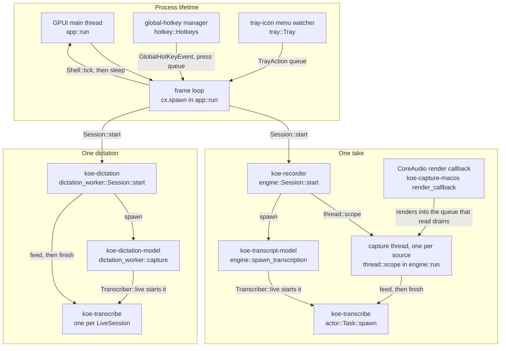
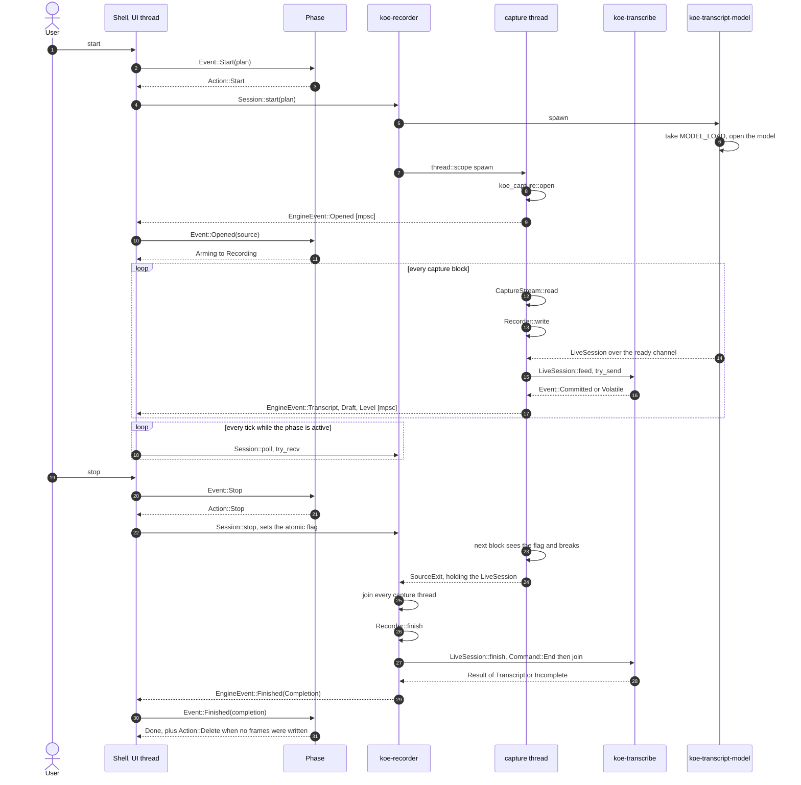
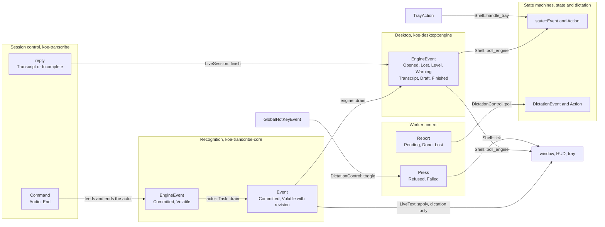
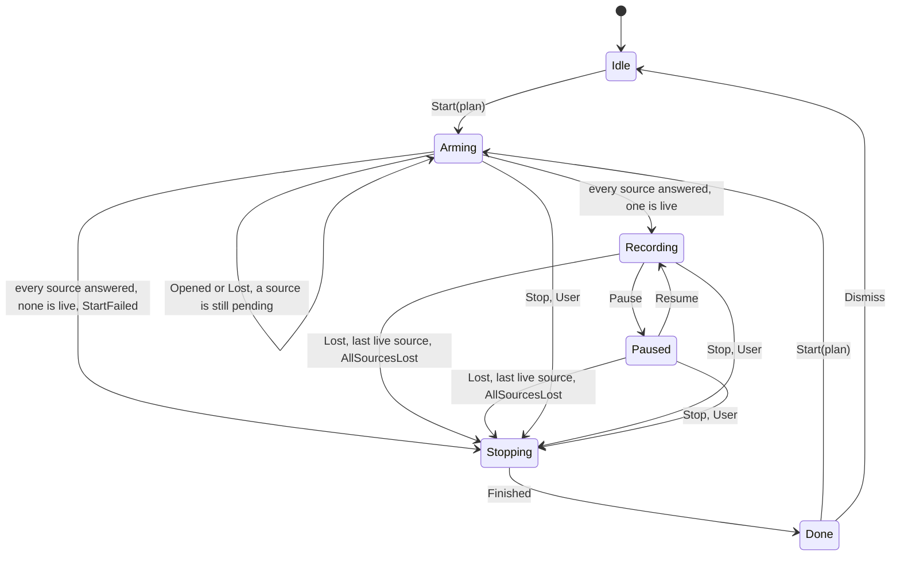
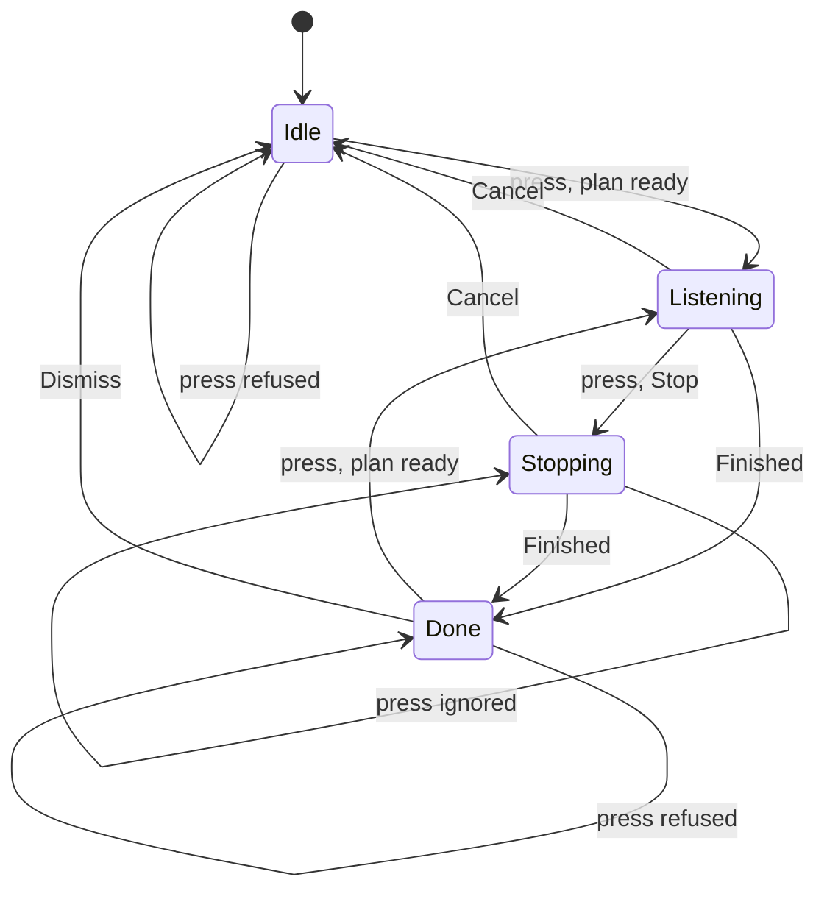
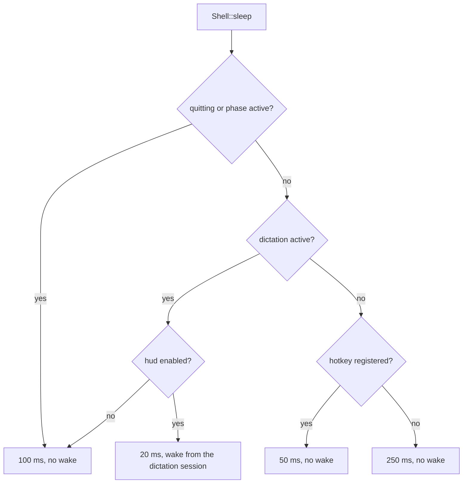

# koe desktop architecture

This file explains how the parts of the desktop app move. Read it before you change `src/app.rs`, `src/engine.rs`, `src/dictation_worker.rs`, or `src/state.rs`.

`README.md` says what the app does and why it is built on GPUI and `tray-icon`. This file says which thread does what, which event type crosses which boundary, and which thread waits on which.

The diagrams live here rather than under the README's Layout section for two reasons. They add about 70 lines of Mermaid on top of five tables, which would push the README's Layout table off the screen for a reader looking up a file's role. And the README is the page a user reads to install and run the app, so the runtime model belongs one link away. The Layout section links here instead.

Every claim here was read from the source at commit `85ed6b7`. Entries name symbols rather than line numbers, because line numbers drift and a symbol survives a rename of its neighbours. Section 6 gives the commands that check this file against the code.

## 1. Threads and lifetimes

Three lifetimes cover every thread. The process runs the GPUI loop, the frame loop, the hotkey manager, and the tray watcher. A take runs a recorder thread, one capture thread per source, one model thread, and one recognition thread per source. A dictation runs one worker thread, one model thread, and one recognition thread.

| Thread | Starts at | Lifetime | Handle held by | Blocks on | Ends when |
| --- | --- | --- | --- | --- | --- |
| GPUI main | `app::run` | process | GPUI | the platform event loop | `cx.quit()` |
| frame loop | `cx.spawn` in `app::run` | process | nobody, the task is detached | `timer(delay)` or `Wake::wait` | never, `cx.quit()` ends the process |
| `koe-recorder` | `engine::Session::start` | one take | `engine::Session` | joining its capture threads | the file is finalized and every session is finished |
| capture thread, one per source | `scope.spawn` in `engine::run` | one take, one per source | `thread::scope` | `CaptureStream::read` | the stop flag is set and the blocking read returns |
| `koe-transcript-model` | `engine::spawn_transcription` | one take | nobody, the handle is dropped | `MODEL_LOAD`, then `Transcriber::new` | a stop check, or the work finishes |
| `koe-transcribe` | `actor::Task::spawn` | one stream, one per `LiveSession` | `LiveSession.handle` | `commands.recv()` | `Command::End`, or the command channel closes when `LiveSession` drops |
| `koe-dictation` | `dictation_worker::Session::start` | one dictation | `dictation_worker::Session` | `CaptureStream::read` | the stop or cancel flag is set and the read returns |
| `koe-dictation-model` | `dictation_worker::capture` | one dictation | nobody, the handle is dropped | `MODEL_LOAD`, then `Transcriber::new` | a stop check, or the work finishes |
| CoreAudio render callback | `render_callback` in `koe-capture-macos` | one capture stream | the HAL | invoked once per audio buffer | `AudioOutputUnitStop` in `Unit::drop`, when the stream drops |
| `global-hotkey` manager | `Hotkeys::new` | process | `Hotkeys` | a 50 ms poll inside the library | `Drop` asks it to stop, and does not join it |

Two more threads come from libraries. `tray-icon`'s menu watcher is joined when `TrayIcon` drops. GPUI's background executor owns its own workers and timer thread.

On Linux the capture read is `pa_simple_read` on the capture thread itself, so a Linux take spawns no extra thread for audio.



### Which thread waits on which

The shell never blocks on a worker. It reads `engine::Session::poll` and `dictation_worker::Session::poll`, both of which are `try_recv`, from the frame loop. Every wait below is inside a worker.

- **The recorder joins its capture threads.** `engine::run` collects each scoped handle with `handle.join()` to pick up the thread's `SourceExit`. `thread::scope` would join them anyway. A capture thread only returns once its blocking read returns, so a stuck device holds the recorder here.
- **The recorder joins every recognition thread.** After the file is finalized, `finish_transcriptions` calls `LiveSession::finish` per source, which sends `Command::End`, joins the actor, and then blocks on the reply. Both the join and the reply read are unbounded, and the doc comment on `finish` says so. A native call that never returns inside the engine keeps the take in `Stopping` forever.
- **Neither `Drop` waits.** `Drop for engine::Session` and `Drop for dictation_worker::Session` set the stop flag and return. Dropping the last handle lets the process exit while `koe-recorder` is still flushing. `Shell::quit` stops both sides, gives them two seconds to report, and calls `cx.quit()` when the deadline passes.
- **`LiveSession` has no `Drop`.** Dropping one detaches the actor. The actor's `commands.recv()` fails once the sender drops, so it returns, sends the transcript to a reply nobody reads, and exits.
- **Two model threads are never joined.** `koe-transcript-model` and `koe-dictation-model` drop their `JoinHandle` at the spawn site, so their exit is unobserved. They stop at their next stop check.
- **`koe-transcribe` is joined only by `LiveSession::finish`.** Everywhere else the thread is detached.

A panic in `koe-recorder` before it sends `Finished` leaves the shell with `session: Some(..)` and no report. The two second quit deadline is the only way out.

## 2. One take, end to end

The normal path of one microphone take. `Level`, `Warning`, and the second source are left out.



The shutdown order matters and the code comments say why. The capture threads stop first. The recorder finalizes the file next. Every recognition session finishes last, because `LiveSession::finish` can block inside the engine, and a stuck flush must not leave the audio file unfinalized.

## 3. Event types by layer

Seven rows cover every type that crosses a thread boundary. Each layer restates what it needs in its own vocabulary.

| Type | Crate and module | Variants | Produced by | Consumed by |
| --- | --- | --- | --- | --- |
| `EngineEvent` | `koe-transcribe-core`, recognition | `Committed`, `Volatile` | the speech backend | the actor, through `EngineSession::poll` |
| `Event` | `koe-transcribe-core`, recognition | `Committed { text, start_ms, end_ms }`, `Volatile { text, revision }` | the actor's `drain` | `LiveSession::poll` on the caller's thread |
| `Command` | `koe-transcribe`, session control | `Audio(Vec<f32>)`, `End` | `LiveSession::feed` and `finish` | the actor's `recv` loop |
| `EngineEvent` | `koe-desktop::engine`, desktop | `Opened`, `Lost`, `Level`, `Warning`, `Transcript`, `Draft`, `Finished` | the recorder, capture, and model threads | `Shell::poll_engine` |
| `state::Event` and `state::Action` | `koe-desktop::state`, state machine | `Start`, `Opened`, `Lost`, `Stop`, `Pause`, `Resume`, `Finished`, `Dismiss`, and `Start`, `Stop`, `Delete`, `Pause`, `Resume` | the shell, the tray, and the recorder's events | `Phase::reduce`, then `Shell::run` |
| `DictationEvent` and `DictationAction` | `koe-desktop::dictation`, state machine | `Finished`, `Dismiss`, and `Start`, `Stop`, `Cancel`, `Refuse` | the worker report and the window | `Dictation::reduce`, then `DictationControl::run` |
| `Report` | `koe-desktop::dictation_worker`, dictation worker | `Pending`, `Done(DictationOutcome)`, `Lost` | `koe-dictation` | `DictationControl::poll` |

Two more types carry intent toward the shell. `tray::TrayAction` (`Start`, `Stop`, `CancelDictation`, `Show`, `ShowSettings`, `OpenFolder`, `Quit`) comes from the menu. `dictation_control::Press` (`Refused`, `Failed`) is the answer to one hotkey press. `Report` lives in the desktop worker. The recognition crates have no `Report`, and the press type is in `dictation_control`, not `hotkey`.



### Conversions

| From | To | Function | Mapping |
| --- | --- | --- | --- |
| `EngineEvent::Committed` | `Event::Committed` | `actor::Task::drain` | copies the fields and appends a `Segment` |
| `EngineEvent::Volatile` | `Event::Volatile` | `actor::Task::drain` | increments the revision counter and carries it |
| any other `EngineEvent` | dropped | `actor::Task::drain` | wildcard arm, so a new backend variant is silent |
| `Event::Committed` | `engine::EngineEvent::Transcript` | `engine::drain` to `emit_utterance` | stamps `at` from `start_ms`, drops `end_ms` |
| `Event::Volatile` | `engine::EngineEvent::Draft` | `engine::drain` | stamps `at` with the arrival time, drops `revision` |
| any other `Event` | dropped | `engine::drain` | wildcard arm on a non-exhaustive enum |
| a segment past the last emitted one | `EngineEvent::Transcript` | `engine::finish_transcription` | replays what a batch model reports at the stop |
| end of a source | `EngineEvent::Draft` with empty text | `engine::finish_transcription` | the empty text is the clear signal |
| a device or recorder error | `EngineEvent::Lost` | `engine::pump` | the error's `Display` becomes `message` |
| the peak of a block | `EngineEvent::Level` | `engine::pump` | every 100 ms, zero while paused |
| `EngineEvent::Opened` | `state::Event::Opened` | `Shell::poll_engine` | unchanged |
| `EngineEvent::Lost` | `state::Event::Lost` | `Shell::poll_engine` | also sets the window notice |
| `EngineEvent::Finished` | `state::Event::Finished` | `Shell::poll_engine` | saves the transcripts first, then reduces |
| `EngineEvent::Level`, `Warning`, `Transcript`, `Draft` | shell fields | `Shell::poll_engine` | drawn and never reduced into the phase |
| `Report::Done` | `DictationEvent::Finished` | `DictationControl::poll` | unchanged |
| `Report::Lost` | `DictationEvent::Finished` | `DictationControl::poll` | synthesizes a `Thread` failure so no state waits forever |
| `Report::Pending` | nothing | `DictationControl::poll` | returns early |

### Threads against event types

Which thread holds which end of each type. A dash means the thread never touches that type.

| Thread | Sends | Receives | Calls |
| --- | --- | --- | --- |
| GPUI main, the UI | `state::Event` into `Phase::reduce`, `DictationEvent` into `Dictation::reduce` | `EngineEvent` through `Session::poll`, `Report` through `DictationControl::poll`, `TrayAction`, press counts | `Shell::run` for each `Action` |
| frame loop | nothing | nothing, it only calls `Shell::tick` | `Shell::tick`, `Wake::wait` |
| `koe-recorder` | `Finished`, the `Draft` with empty text that clears a source's tail, and the `Warning` for a dead capture thread, a missing transcript, an incomplete one, or dropped audio | nothing | the joins, `Recorder::finish`, `LiveSession::finish` |
| capture thread | `Opened`, `Lost`, `Level`, `Transcript`, `Draft`, and the `Warning` for a dropped backlog or a stopped transcription | `Event` through `LiveSession::poll`, and the ready channel's `Result<LiveSession, String>` | `CaptureStream::read`, `Recorder::write` |
| `koe-transcript-model` | only the ready channel's `Result<LiveSession, String>`. The capture thread turns its error into the `Warning`, and the recorder turns a failed spawn into one | nothing | `Transcriber::new` and `transcriber.live` |
| `koe-transcribe` | `Event`, the reply `Transcript` or `Incomplete`, `EngineEvent` from the backend | `Command` | `EngineSession::feed`, `finish`, and `poll` |
| `koe-dictation` | `Report::Done`, `Command::Audio` and `Command::End` through `feed` and `finish` | `Event` through `LiveSession::poll` | the platform's text insertion |
| `koe-dictation-model` | the ready channel's `Result<LiveSession, DesktopError>` | nothing | `Transcriber::new` and `transcriber.live` |
| CoreAudio render callback | nothing | nothing | fills the capture pipeline's sink, so the capture thread's `read` has audio |
| `global-hotkey` manager | press ids into the process-wide queue | nothing | the press count that `Hotkeys::presses` drains |
| `tray-icon` menu watcher | `TrayAction` into the tray queue | nothing | nothing in koe |

The recognition types stop at the actor. `Command` travels down into `koe-transcribe` and `Event` travels back up, and neither reaches the shell. The desktop layer restates what it needs as `engine::EngineEvent`. The dictation path does hand one recognition type to the shell, as plain text: `LiveText` becomes the `String` the HUD reads, so no `Event` value is stored in the shell.

### Channels

| Channel | Kind | Sender | Receiver |
| --- | --- | --- | --- |
| take events | unbounded `mpsc` | recorder, capture threads, model thread | `engine::Session.events` |
| model ready, one per source | unbounded `mpsc` | `koe-transcript-model` | that source's capture thread |
| dictation report | unbounded `mpsc`, one message | `koe-dictation` | `dictation_worker::Session.events` |
| dictation model ready | unbounded `mpsc`, one message | `koe-dictation-model` | the `koe-dictation` thread |
| recognition commands | `sync_channel(64)` | `LiveSession.commands` | the actor |
| recognition events | unbounded `mpsc` | the actor | `LiveSession.events` |
| recognition reply | `sync_channel(1)` | the actor | `LiveSession::finish` |
| dictation transcript | none, `Arc<Mutex<LiveText>>` plus a `Wake` | `koe-dictation` | `Shell::hud_state` |
| tray actions | `Arc<Mutex<VecDeque>>` | the library's menu handler | `Tray::poll` |
| hotkey presses | process-wide `OnceLock<Arc<Mutex<VecDeque>>>` | the library's event handler | `Hotkeys::presses` |

The recognition command queue is the only bounded data channel a producer can overflow. When it is full, `LiveSession::feed` drops the chunk and counts the frames in `pending` and `total`. The actor then feeds silence for those frames so engine timestamps keep matching the recording, and the desktop reports the total as an incomplete-transcript warning.

## 4. State machines

### The take: `Phase`

`Phase` owns one take. `Phase::reduce` is one exhaustive match over `(phase, event)` and returns the work the shell must run. The type is pure, so every transition is unit-tested.



The variants carry payloads. `Arming` holds `live` and the `pending` sources. `Recording` and `Paused` hold `live`. `Stopping` holds `live` and a `StopCause`. `Done` holds a boxed `Done` record with the output path, the summary, the failure, the duration, the warning, and whether the empty take's session was removed.

Rows that a linear `Idle` to `Done` story gets wrong.

- `Done` is a start state. `Done` plus `Start` arms a new take, and a refused start puts the same `Done` back.
- `Stopping` has three causes. `Stop` gives `User`. The last `Lost` gives `AllSourcesLost` from either `Recording` or `Paused`. The last arming answer with nothing live gives `StartFailed`. `Stop` in `Stopping` is an explicit no-op, so the engine gets exactly one `Stop` per take.
- Pause survives losing a source. `Paused` plus `Lost` stays paused until every source is gone.
- A take stopped while paused keeps its frozen clock through `Stopping`, because `Live::elapsed` subtracts the open pause interval.
- `Opened` adds a source even if it was not in `pending`, so this arm is not the mirror of `Lost`.
- `Finished` from `Idle` is ignored. A completion that arrives after a `Dismiss` is dropped.
- `Action::Delete` is decided by `summary.frames == 0` alone. The store's answer comes back later through `Phase::set_session_removed`, so the `Done` record can disagree with what the store did.

### The dictation: `Dictation`

`Dictation` owns one dictation. A hotkey press goes through `Dictation::toggle`, the worker's report through `Dictation::reduce`, and the menu's cancel through `Dictation::cancel`.



A refusal keeps the phase and returns `DictationAction::Refuse` with the sentence to show. `start` checks the meeting take first, then whether a model is configured.

### Mutual exclusion

One microphone, two owners. Two functions enforce it.

| Rule | Function | Message |
| --- | --- | --- |
| a press is refused while a take is active | `dictation::start` reads `DictationContext::meeting_active`, which `Shell::tick` fills from `Phase::is_active` | `MEETING_ACTIVE` |
| a press is refused while no model is set | `dictation::start` | `MODEL_MISSING` |
| a take is refused while a dictation is active | `dictation::meeting_start_allowed`, called from `Shell::start_recording` | `MEETING_BLOCKED` |

Both predicates count the closing state as active. `Phase::is_active` includes `Stopping`, and `Dictation::is_active` includes `Stopping`. A dictation is therefore refused while a take is still saving, and a take is refused while a dictation is still transcribing.

`Dictation::Stopping` counts as active and a `Finished` report is still in flight, yet `cancel` moves it straight to `Idle`. The late `Finished` is dropped. A cancel discards the take, so dropping it is the intent.

## 5. Polling and wake

The frame loop runs `Shell::tick`, then sleeps. `Shell::sleep` picks the delay and, for one branch, a `Wake` that can end the sleep early.



| State | Tick | Wake | What the tick draws |
| --- | --- | --- | --- |
| quitting | 100 ms | none | nothing new, the quit check runs |
| a take in `Arming`, `Recording`, `Paused`, or `Stopping` | 100 ms | none | the take card, badge, elapsed seconds, tray status |
| a dictation `Listening` or `Stopping`, HUD on | 20 ms | the dictation session's | the transcript card, badge, elapsed seconds |
| a dictation `Listening` or `Stopping`, `KOE_HUD` off | 100 ms | none | the tray status only |
| idle, hotkey registered | 50 ms | none | a press is picked up within 50 ms |
| idle, no hotkey | 250 ms | none | the tray only |

`Wake` is one pending flag and one waker slot, with no queue. `LiveTranscript::apply` marks it after every folded recognition event, and `LiveTranscript::commit` marks it after the final inference. Both run on `koe-dictation`, so the dictation transcript is the only thing that shortens a sleep.

A take has no wake at all. Its progress and transcript are sampled at the 100 ms tick. So the meeting UI lags a commit by up to 100 ms, and `EngineEvent::Transcript` reaches the window on the same sample.

## 6. Keeping this file true

Change this file when you change any of these:

- **Add or remove a thread.** Update the table and the flowchart in section 1, and the waits list under it. A thread name is the string passed to `thread::Builder::name`, so grep that name.
- **Add or remove a variant** of `EngineEvent`, `Event`, `Command`, `state::Event`, `state::Action`, `DictationEvent`, `DictationAction`, or `Report`. Update the layer table and the flowchart in section 3. A wildcard arm in `actor::Task::drain` or `engine::drain` drops a new variant silently, so the doc is the only place that notices.
- **Change a conversion** between any two of those types. Update the conversion table.
- **Add a variant to `Phase` or `Dictation`.** Update the diagram and the transition notes in section 4.
- **Change a branch in `Shell::sleep`, or add a wake.** Update section 5.
- **Change who joins or blocks on whom.** Update the waits list in section 1 and the shutdown order in section 2.

The ground truth is four greps. Run them and compare the output against sections 1, 3, and 5.

```console
grep -rn 'thread::Builder::new()\|scope.spawn\|thread::spawn\|\.name(' apps/koe-desktop/src crates/koe-transcribe/src
grep -n 'pub enum' apps/koe-desktop/src/engine.rs apps/koe-desktop/src/state.rs apps/koe-desktop/src/dictation.rs apps/koe-desktop/src/dictation_worker.rs crates/koe-transcribe-core/src/engine.rs crates/koe-transcribe-core/src/event.rs crates/koe-transcribe/src/actor.rs
grep -n 'fn sleep\|TICK\|Duration::from_millis' apps/koe-desktop/src/app.rs
grep -n 'fn reduce\|fn toggle\|fn cancel' apps/koe-desktop/src/state.rs apps/koe-desktop/src/dictation.rs
```

The last match in the first grep is a thread that `wake.rs` starts inside a test. Every other match should have a row in section 1.

`cargo test -p koe-desktop --features linux` covers the state machines and the sleep branches, so a transition or tick change that this file has not caught will usually fail there first.

Two changes are already scheduled and will stale this file. Removing `EngineEvent::Level` removes a variant from the layer table, one conversion row, one column of the thread matrix, and the `levels` field that `Shell::poll_engine` and `ui.rs` read. Moving a take onto a wake would add a row to section 5 and a sender to section 1.
